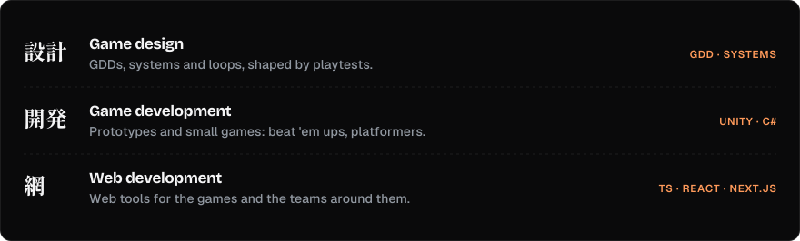

  

 writing a GDD at 3 a.m.">

I'm **Simão**, a **Videogames student at Lusófona University**. I go by **@TxgerDev** and I build things that shouldn't work but somehow do: games first, and the web tools that grow around them. I care about putting how I see the world into what I make.

  

 

